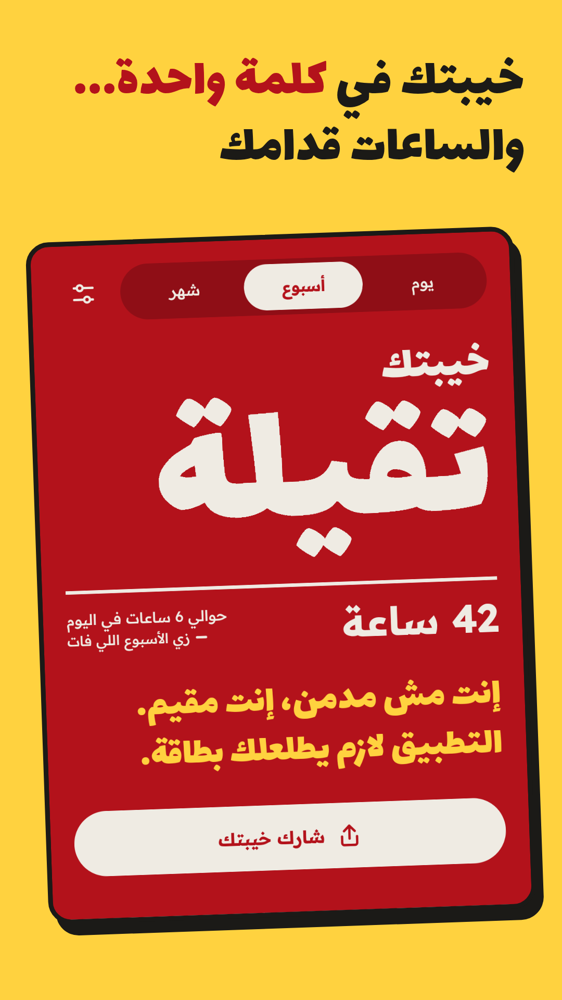
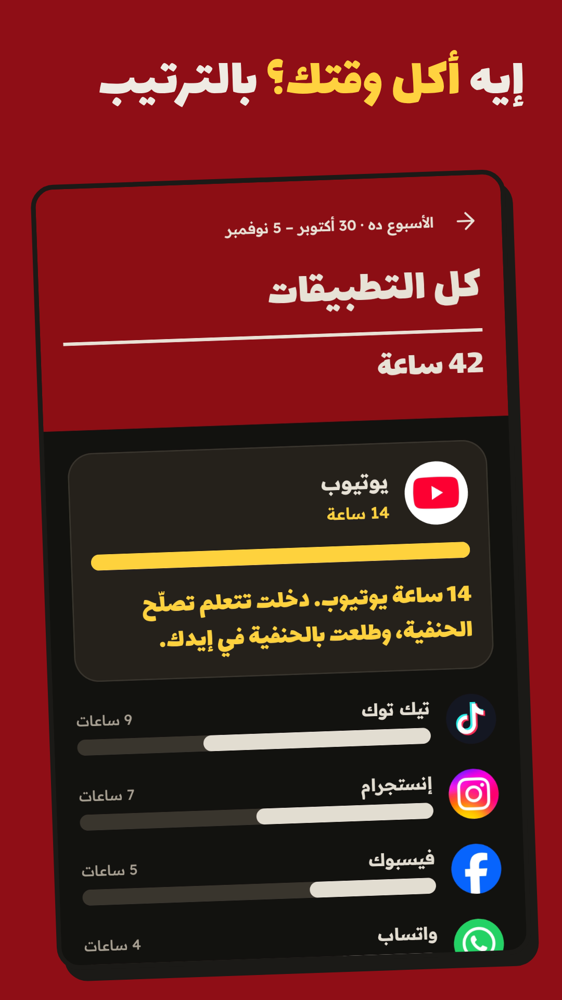
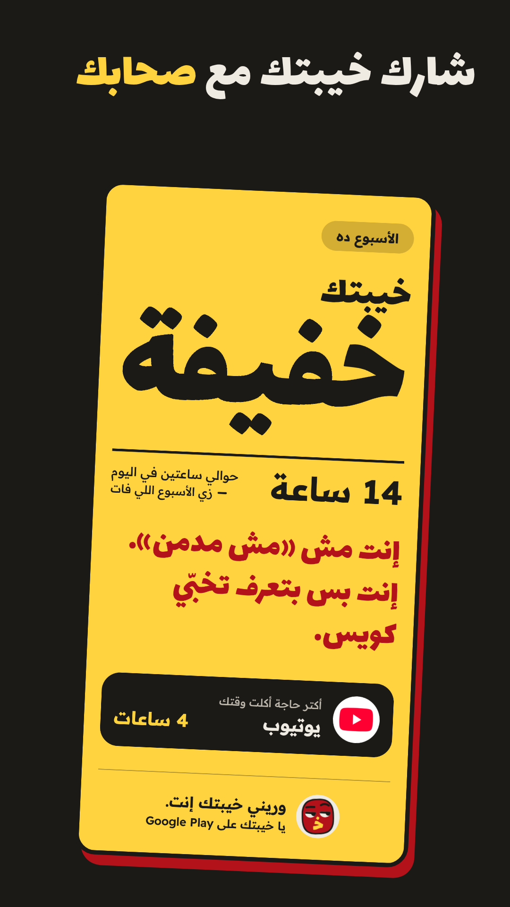
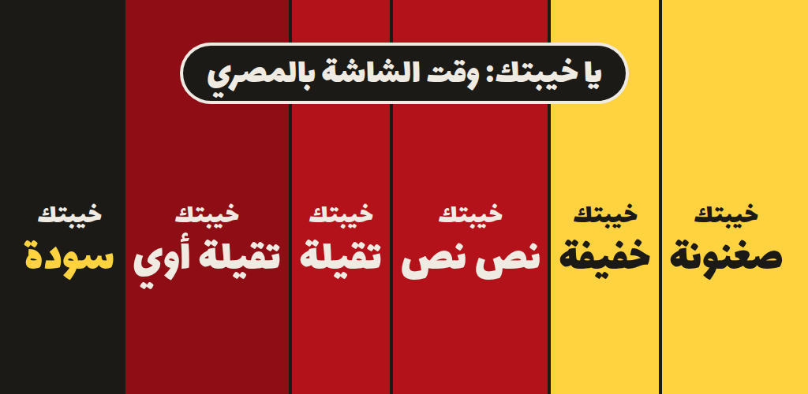

<p align="center">
  
</p>

<h1 align="center">Ya Khebtak · يا خيبتك</h1>

<p align="center"><b>Your screen time, roasted in Egyptian Arabic.</b></p>
<p align="center" dir="rtl">كام ساعة راحت على الريلز؟ وكان ممكن تعمل فيهم إيه؟ اعرف… ومتزعلش.</p>

<p align="center">
  <b>Google Play</b> (closed test, early access) · <a href="https://yakhebtak.app">yakhebtak.app</a>
</p>

<p align="center">
  
  
  
  
</p>

An Android app I designed, built and tested on my own, now in early access (alpha) on Google Play: Kotlin and Jetpack
Compose, a release pipeline in GitHub Actions, written release checks, a privacy-first design with no internet
permission, and a website run on Terraform.

## By the numbers

**800+** hand-written roast lines · **242** tests · **0** crashes in 5,000-event stress tests · **185 ms** cold start

## What it is

Screen-time apps tell you a number and a graph. **Ya Khebtak tells you what Egypt would say.**

It reads how long you spent on your phone and answers in the voice of everyday Egypt: one big verdict word, the hours,
one line that stings, and a reminder of what those hours could have been. Funny first, true second, never preachy.

<blockquote dir="rtl"><b>خيبتك تقيلة</b><br>42 ساعة · حوالي 6 ساعات في اليوم<br>«إنت مش مدمن، إنت مقيم. التطبيق لازم يطلعلك بطاقة.»</blockquote>

## Features

- **The verdict.** Six levels from «صغنونة» (tiny) to «سودة» (pitch black), on Day, Week and Month.
- **A hand-written roast library.** 800+ lines and growing: verdicts, app-specific roasts, alerts, recaps and
  praise, each one written and approved by hand. Nothing is generated at runtime.
- **"In that time…" cards.** Cards turn your hours into something real: sleeper trains to Aswan, felucca rides on
  the Nile, broken things you could have fixed at home. Every fact on a card is checked against a source.
- **Live alerts** when you cross your own daily limits (30 min, 1 h and 3 h by default), plus a daily and a Friday recap.
- **The share picture.** Your verdict as a 1080 px image for WhatsApp and Instagram stories.

## Privacy by design

- **Nothing leaves the phone.** App names, minutes and history stay on the device. The app has **no internet
  permission**, and the release build contains no network code (checked by decompiling it).
- **No accounts, no ads, no analytics, no crash SDK.** Cloud backup is switched off, so usage history is never copied off
  the phone.
- The app asks for two permissions: usage access (read through Android's own `UsageStatsManager`, granted by you in Settings) and
  notifications. No Accessibility Service, no `QUERY_ALL_PACKAGES`.

Full policy: [yakhebtak.app/privacy](https://yakhebtak.app/privacy/)

## Engineering

| Area | Details |
|---|---|
| Platform | Android 8.0+ (minSdk 26), targetSdk 37 |
| Stack | Kotlin, coroutines + Flow, Jetpack Compose (Material 3), Room, WorkManager |
| Tests | 242 unit tests: 144 on every build + 98 screenshot tests |
| Size | ~1.5 MB download (R8 code and resource shrinking) |

**Release pipeline (GitHub Actions)**

- Every push to `main` and every pull request runs the unit tests, Android lint and a debug build.
- Pushing a `vX.Y.Z` tag builds the signed release bundle (AAB). The upload key comes from repository secrets, is
  written to the runner's temp folder only for the build and deleted afterwards, even when the job fails.
  The signature is verified with `jarsigner` before anything is published.
- The AAB and the R8 `mapping.txt` go into a draft GitHub Release, so crash stack traces in Play Console can be
  retraced for every version.

**Testing and QA**

- **Screenshot tests** (Robolectric + Roborazzi) render every screen on the JVM, no phone needed, including big-font and
  English-phone variants.
- **Release checks**, written up before the first upload, on Android 8.0 (small 360 dp screen) and Android 17:
  - system font size 1.3× and 2.0× on every screen: 7 layout and TalkBack bugs found, fixed and locked in by tests
  - touch targets of at least 48 dp, labels for every control TalkBack reads
  - monkey runs of 5,000 random events: 0 crashes
  - the background job under Doze and app standby buckets
  - release build audit: permissions, no tracker or network code, lint with 0 errors
  - cold start on a Pixel 10 Pro: 185 ms median (release build)

**Architecture**

```
 UsageStatsManager ──► data/usage ──► Room (minutes per app per day)
                                          │
 content/*.json ─────► data/content ──────┤
                                          ▼
                     domain: pure Kotlin, no Android imports
                     RoastEngine · conversions · alert rules
                          │                          │
                          ▼                          ▼
              Compose UI: Main, Details,     WorkManager job (~15 min):
              Settings, share picture        live alerts, daily + Friday recap
```

- **Pure-Kotlin domain.** Every rule is unit-tested: no line repeats within 7 days, praise only after a real drop
  (more than 20%), the right Arabic word form for every count.
- **Content as data.** Every line the user reads lives in JSON files bundled with the app, never in code. Tests check
  the files: unique ids, only known placeholders, a source for every fact, clean Arabic punctuation.
- **Few dependencies.** Compose, Room and WorkManager; no DI framework, no network library.

## Localization

- **Right-to-left first.** Every screen is designed RTL and checked on English-language phones too,
  where system popups would otherwise follow the phone's language.
- **Egyptian dialect everywhere**, never Modern Standard Arabic, with Western digits.
- **Arabic count forms** (1, 2, 3–10, 11+): «ساعة / ساعتين / ساعات».
- **Bidi-safe text.** English app names are wrapped in Unicode isolates, so «Netflix» never takes the number next to
  it; notifications start with a right-to-left mark.
- **Store listing.** Every line of the Play description starts and ends with a right-to-left mark, so it reads
  correctly on phones set to English.

## Website and infrastructure

- [yakhebtak.app](https://yakhebtak.app) is a static site with no JavaScript, hosted on Cloudflare Pages.
- **All in Terraform:** the Pages project, both custom domains, the DNS records and the email forwarding for the
  contact address.
- **Deployed by GitHub Actions:** a build step copies an allowlist of site files, then Wrangler uploads them, so nothing
  else in the repo is ever published.
- **Security headers** on every page: HSTS (one year, subdomains included) and a strict Content Security Policy
  (`default-src 'none'`, no scripts, no framing).

## Design

<p align="center"></p>

Direction **«البوستر»** (the poster): one huge word, the hours, one line. Red `#B3121B`, yellow `#FFD23F`, ink `#1B1A17`,
page `#EFEBE3`. The colour follows the level: yellow for a light week, red for a heavy one, black for «سودة».

The icon is a face whose nose and mouth are the letter «خـ», the first letter of «خيبة», looking at you sideways.

## Copyright

Ya Khebtak is my own idea and my own product.

© 2026 Mohamed Aly. All rights reserved. The name «يا خيبتك» / Ya Khebtak, the icon, the lines, the screenshots and the
design may not be copied, reused or adapted without my written permission. See [LICENSE](LICENSE).

## Status

**Early access (alpha).** The app is in a closed test on Google Play since 9 November 2026: testers are using it every
day and their feedback goes into each build, on the way to Google's approval for the public release. v1 will be free.
The source code is private; this repo is a showcase.

---

<p align="center">© 2026 Mohamed Aly · All rights reserved · <a href="https://github.com/mohamedaly-cloud">GitHub</a> · <a href="https://yakhebtak.app">yakhebtak.app</a> · Instagram, TikTok, X: <b>@yakhebtak</b></p>
